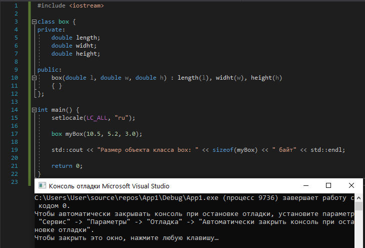
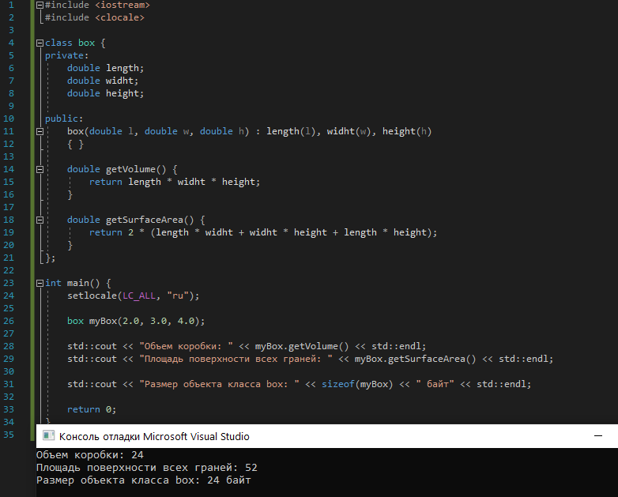
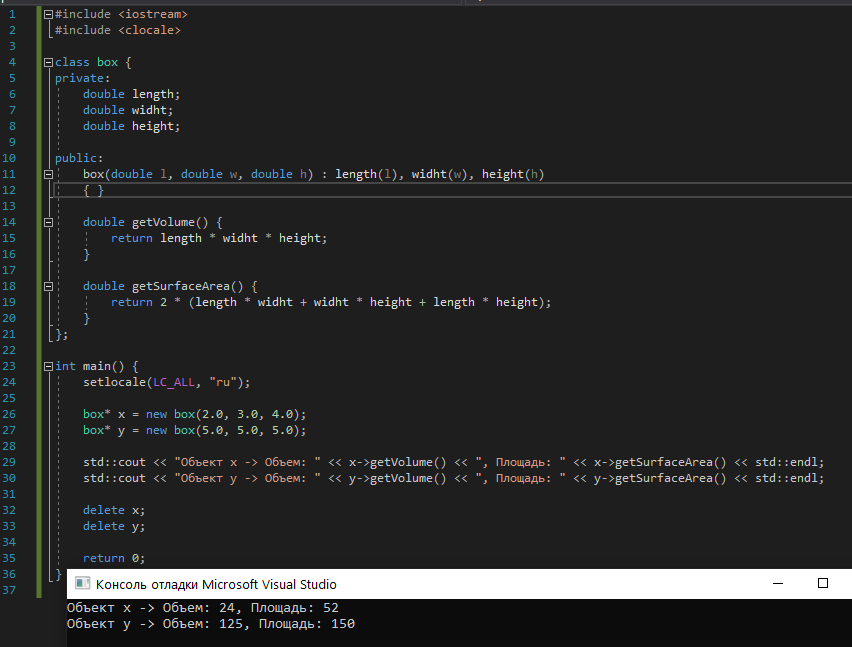
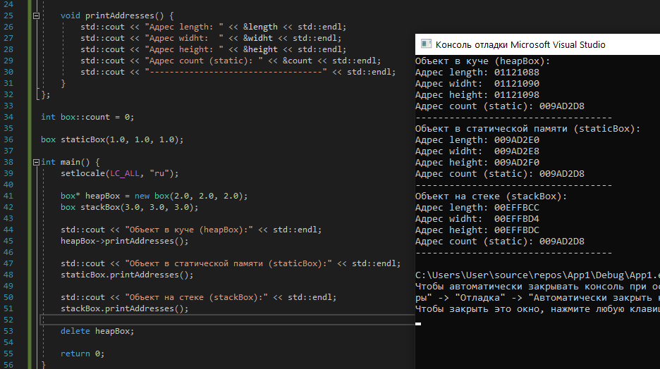
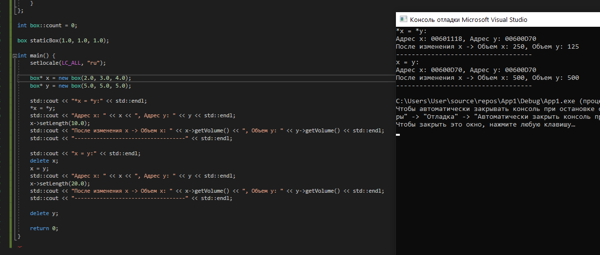
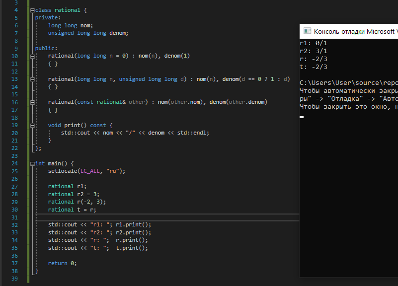
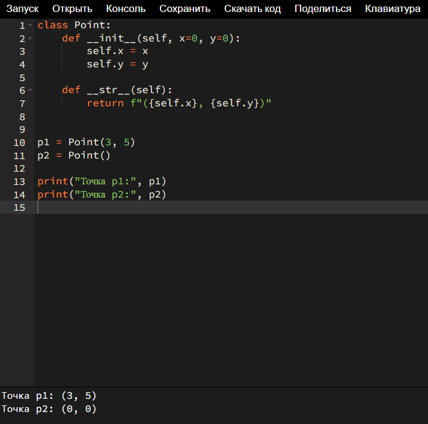
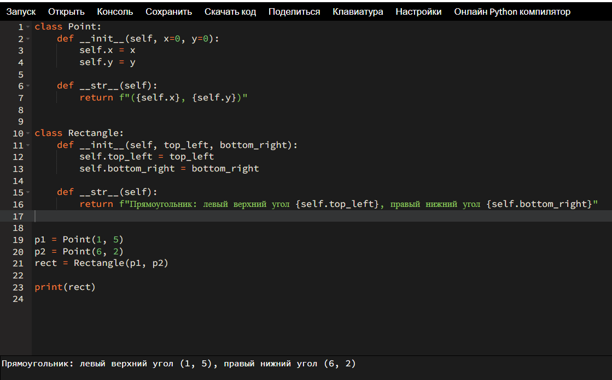
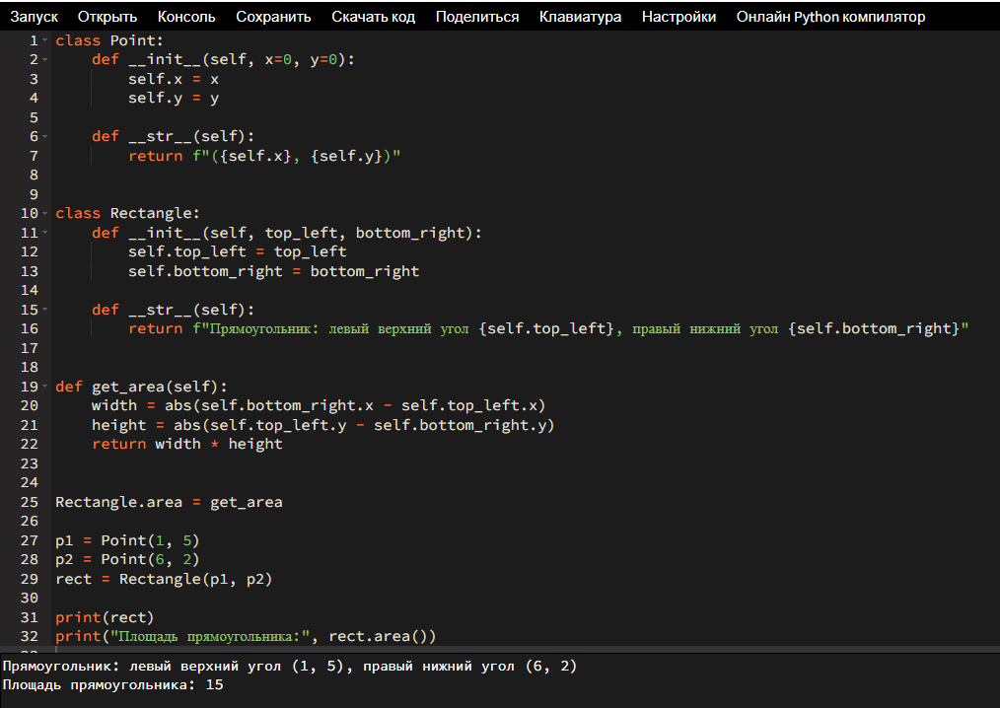
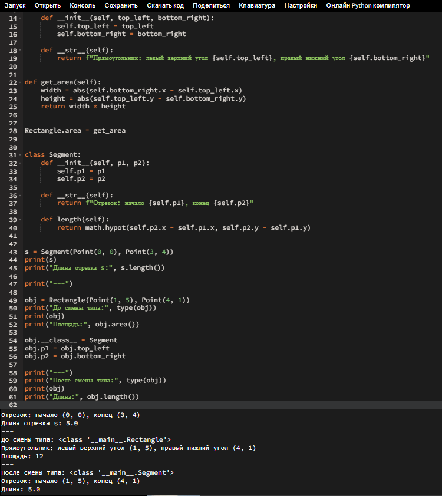

# Языки программирования
## Лабораторная работа 12

**Первые шесть заданий требуется выполнить на языке С++.**
### Задание 1 **(2)**

*Запишите класс* **box** *с тремя скрытыми полями типа с плавающей
точкой:* **length**, **widht**, **height**. *Добавьте в класс инициализирующий
конструктор. Найдите размер одного объекта этого класса с
использованием* **sizeof**.

**Ответ:**



Получилось 24, потому что три переменных типа double, каждая из которых занимает 8 байт.

### Задание 2 **(2)**

*Добавьте в класс методы для вычисления объема коробки и
площади поверхности всех граней. Напишите программу, тестирующую
работу методов. Проверьте, изменился ли размер одного объекта этого
класса. Объясните результат*

**Ответ:**



Размер объекта класса box не изменился. Методы класса не хранятся внутри каждого отдельного объекта, их код размещается в общей памяти программы в единственном экземпляре, а память при создании объекта выдел.

### Задание 3 **(2)**

*Создайте два объекта* **x** *и* **y** *класса* **box** *в куче. Напишите
программу, для проверки работы методов, которая будет использовать
оба объекта. Не забывайте, что объекты созданные в куче следует
освобождать.*

**Ответ:**



Объекты x и y созданы в куче с помощью new, который возвращает указатели на них. Для вызова методов через указатели использован оператор разыменования ->

### Задание 4 **(2)**

*Добавьте в класс одно статическое поле и метод для вывода
адресов всех четырех полей. Создайте три объекта этого класса в
куче, в статической памяти и на стеке. Выведите адреса полей.
Объясните результат.*

**Ответ:**



У статический полей всегда один адрес, т.к. они хранятся не в объекте, в котором определены. Статическое поле всегда в единственном экземпляре и доступно в любом месте в приложении.

### Задание 5 **(2)**

*Напишите программу, которая продемонстрирует разницу между
присваиванием* ```x=y``` *и* ```*x=*y```.

**Ответ:**



В первом случае происходит копирование содержимого объектов. Значения y копируются в x, но это всё еще разные объекты в памяти.

Во втором случае присваивается ссылка, поэтому теперь обе переменные ссылаются на один и тот же объект в памяти.

### Задание 6 **(3)**

*Запишите класс* **rational** *(рациональное число, представленное в
виде дроби).*
```
class rational {
private :
    long long nom;
    unsigned long long denom;
};
```
*Добавьте в класс конструкторы так, чтобы:*

* *по умолчанию дробь инициализировалась как* ```0/1```;
* *работала инициализация* ```rational r = 3;```
* *работала инициализация* ```rational r(-2, 3);```
* *работала инициализация* ```rational t = r;```

**Ответ:**



* Конструктор со значением по умолчанию rational(long long n = 0).  Объединяет в себе конструктор по умолчанию и конструктор преобразования из целого числа.
* Инициализирующий конструктор rational(long long n, unsigned long long d) — принимает числитель и знаменатель
* Конструктор копирования rational(const rational& other) — создаёт копию существующего объекта при инициализации вида rational t = r;.

### Задание 7 **(2)**

*Напишите программу на Python в которой будет определяться
класс* **Point** *с двумя полями* **x** *и* **y**. *Класс должен содержать
конструктор и метод* **__str__** *для создания текстового представления
точки. 

Напишите программу для проверки работы методов.*

**Ответ:**



В классе Point метод `__init__` выступает конструктором и инициализирует координаты x и y (по умолчанию 0). Метод `__str__` переопределяет строковое представление объекта, благодаря чему при передаче экземпляра класса в функцию print() точка выводится в формате (x, y).


### Задание 8 **(2)**

*Напишите программу на Python в которой будет определяться класс*
**Rectangle** *с двумя полями типа* **Point**. *Точки задают левый верхний
и правый нижний угол прямоугольника. Класс должен содержать
конструктор и метод* **__str__** *для создания текстового представления
прямоугольника. 

Напишите программу для проверки работы методов.*

**Ответ:**



Поля Reactangle top_left и bottom_right хранят объекты класса Point, задающие противоположные углы прямоугольника. При вызове print(rect) срабатывает метод `__str__` класса Rectangle, который автоматически вызывает метод `__str__` для обеих вложенных точек.

### Задание 9 **(2)**

*Добавьте в класс функцию для вычисления площади
прямоугольника. Функцию следует добавить не в момент
определения класса, а в процессе работы программы.*

*Проверьте работоспособность функции.*

**Ответ:**



Так как классы в Python являются динамическими объектами, в них можно добавлять новые методы во время выполнения программы. Обычная функция get_area(self), принимающая первым аргументом ссылку на экземпляр self, была присвоена атрибуту класса Rectangle.area, после чего она стала доступна как полноценный метод для всех его объектов.

### Задание 10 **(2)**

*Добавьте в программу класс* **Segment** *с двумя полями типа*
**Point**. *Точки задают концы отрезка. Класс должен содержать
конструктор, метод* **__str__** *для создания текстового представления
отрезка и метод* **length** *для нахождения длины отрезка.*

*Напишите программу для проверки работы методов.*

*Измените тип ранее созданного объекта класса* **Rectangle** *на* **Segment**.
*Объект должен создаваться с типом* **Rectangle**, *а после изменить тип
на* **Segment**.

*Проверьте работу методов до и после изменения типа.*

**Ответ:**



В Python тип существующего объекта можно изменить во время выполнения программы, присвоив его системному атрибуту `__class__` имя нового класса. После смены класса объекту стали доступны методы Segment, а методы Rectangle перестали существовать. Так как в классе Rectangle точки хранились в полях top_left и bottom_right, а методы Segment обращаются к полям p1 и p2, объекту также были добавлены соответствующие ссылки на эти точки.

## Дополнительные задания

### Задание 1 **(20)**

*Напишите на языке С++ класс* **matrix** для работы с матрицами квадратного вида. Напишите методы для нахождения 
определителя матрицы, для сложения и умножения матриц, для умножения матрицы на число.
